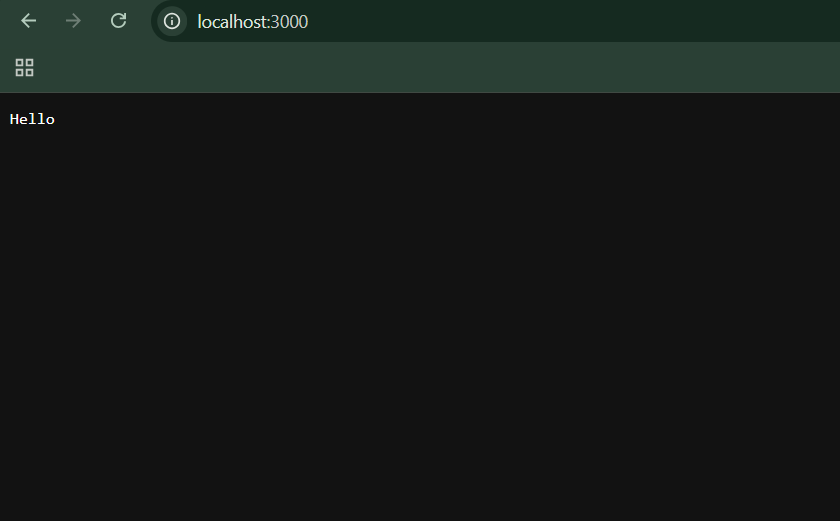
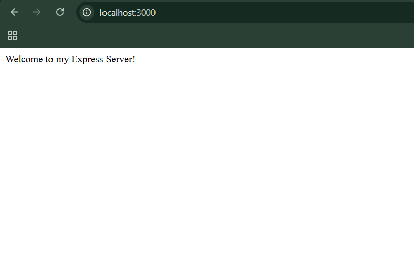
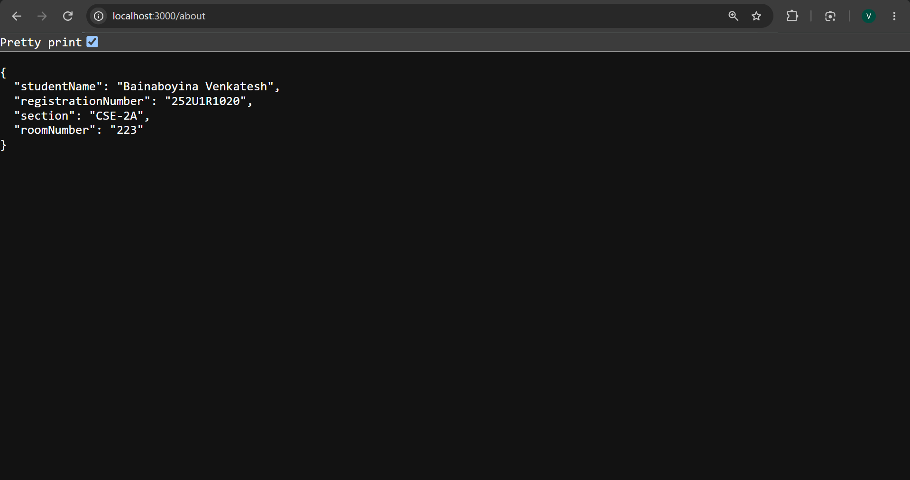
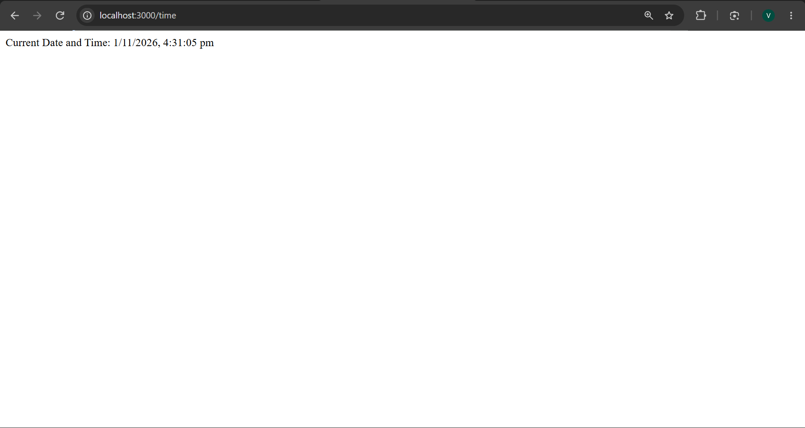
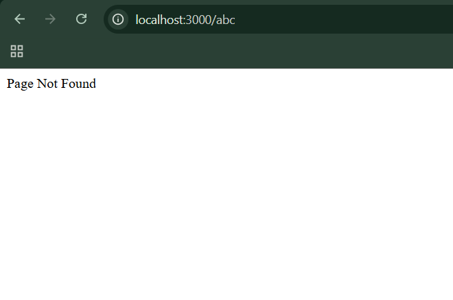

# Lab 1: Node.js and Express server

## Student Details

- **Name:** Bainaboyina Venkatesh
- **Registration Number:** 252U1R1020
- **Section:** CSE-2A(223)

## Live Link


## Objective

The main objective of this lab is to understand how to create a web server using Node.js and Express.js. I created a basic HTTP server using the built-in HTTP module and then developed an Express server to handle different routes and HTTP requests.

## Technologies Used

- Node.js
- Express.js
- JavaScript
- date-fns
- npm (Node Package Manager)

## Project Structure

```text
lab-01/
│
├── screenshots/
│   ├── http-server.png
│   ├── express-server.png
│   ├── home.png
│   ├── about.png
│   ├── time.png
│   └── 404.png
│
├── http-server.js
├── app.js
├── package.json
├── package-lock.json
├── .gitignore
└── README.md
```

## Installation and Setup

### Prerequisites

Before starting this project, I installed Node.js and npm on my system and used Visual Studio Code to write and execute the application.

### Step 1: Initialize the Project

I created a project folder and initialized the Node.js project using the following command:

```bash
npm init -y
```

This command created the `package.json` file, which contains the project information and dependencies.

### Step 2: Install Dependencies

I installed Express.js and date-fns using the following command:

```bash
npm install express date-fns
```

Express.js is used to create the web server and handle routes. I used date-fns to format the current date and time.

### Step 3: Run the HTTP Server

I created a basic server using the built-in HTTP module of Node.js.

To start the HTTP server, I used:

```bash
node http-server.js
```

I accessed the server using:

`http://localhost:3000`

### Step 4: Run the Express Server

I created another server using Express.js.

Before starting the Express server, I stopped the HTTP server because both servers use the same port (3000).

To start the Express server, I used:

```bash
node app.js
```

I accessed the Express server using:

`http://localhost:3000`

### Environment Variables

I did not use any environment variables in this project. The port number 3000 is directly specified in the application.

## Implementation

### HTTP Server Using Node.js

First, I created a basic HTTP server using the built-in `http` module.

- I used `http.createServer()` to create the server.
- I configured the server to send the response `Hello`.
- I started the server using `server.listen()` on port 3000.

### Express Server

After completing the basic HTTP server, I created an Express application.

- I imported the Express package and created an Express application.
- I started the server using `app.listen()` on port 3000.
- I created three GET routes to handle different requests.
- I used a 404 handler to manage requests to unknown paths.

## Endpoints

I created the following GET routes in my Express application.

| HTTP Method | Path | Description | Status Code |
|---|---|---|---|
| GET | `/` | Displays a welcome message. | 200 |
| GET | `/about` | Returns my student information in JSON format. | 200 |
| GET | `/time` | Displays the current date and time using the date-fns package. | 200 |
| GET | Any unknown path | Displays a Page Not Found message. | 404 |

## Screenshots

I captured screenshots while testing the HTTP server and Express endpoints. I stored all the screenshots in a separate folder named `screenshots`.

### HTTP Server

This screenshot shows the HTTP server running successfully and returning the Hello response.



### Express Server

This screenshot shows the Express server running successfully on port 3000.


### Home Route – GET /

This screenshot shows the welcome message returned by the home route.



### About Route – GET /about

This screenshot shows my student information returned in JSON format.



### Time Route – GET /time

This screenshot shows the current date and time returned by the time route.



### Unknown Route – 404

This screenshot shows the 404 Page Not Found response when I access an undefined route.



## Problems Faced and Solutions

- **npm execution policy:** Initially, I faced an issue while executing npm commands in PowerShell. I resolved it by changing the execution policy for the current user.
- **Port conflict:** Both servers use port 3000, so I learned to stop one server before starting the other.
- **Date formatting:** I used the date-fns package to format the current date and time into a readable format.

## Conclusion

Through this lab, I learned how to create a basic web server using Node.js and how to develop a server using Express.js. I also learned how to create GET routes, handle HTTP requests and responses, return JSON data, display the current date and time, and handle unknown routes using a 404 status code.