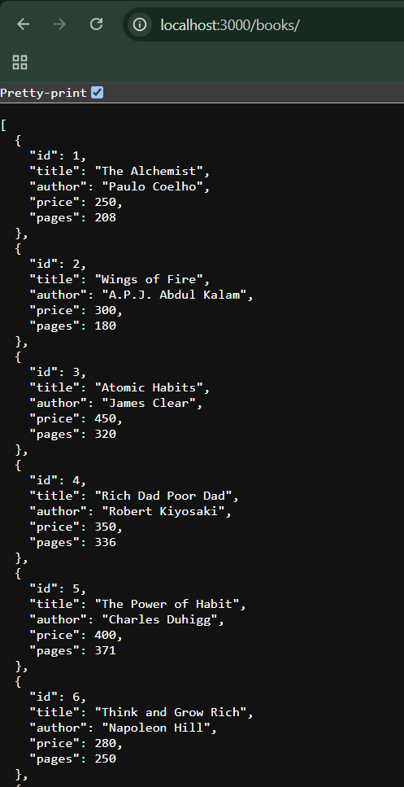
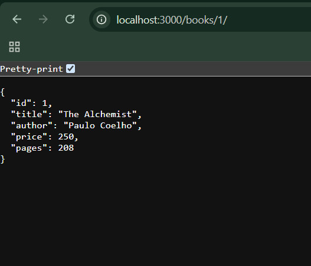
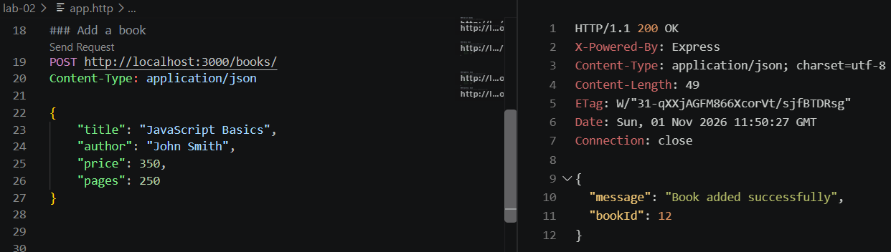
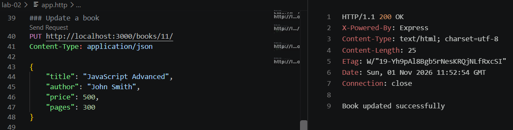
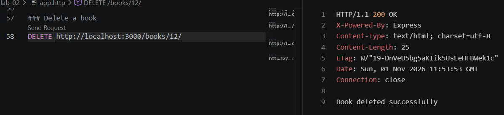
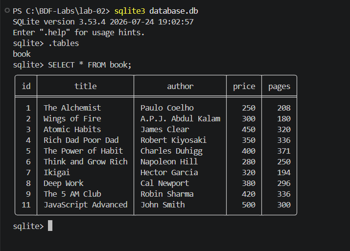
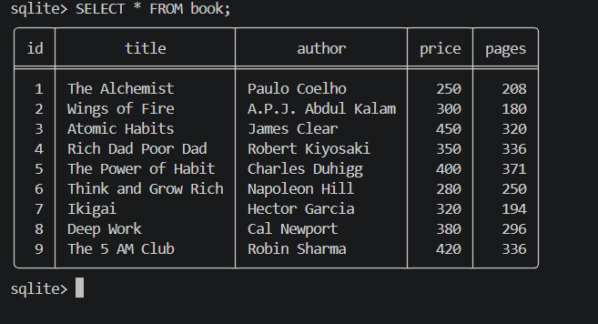

# Lab 2: SQLite Database and CRUD Routes

**Name:** Bainaboyina Venkatesh 
**Registration Number:** 252U1R1020  
**Section:** CSE-2A &  223

## Live Link

https://bdf-labs-126m.onrender.com

## Project Description

This project demonstrates how to connect an Express.js application to an SQLite database and perform CRUD (Create, Read, Update, and Delete) operations through REST API endpoints.

A SQLite database named `database.db` is used to store book details such as ID, title, author, price, and pages.

## Technologies Used

- Node.js
- Express.js
- SQLite
- sqlite3
- sqlite
- Nodemon

## Installation

Navigate to the `lab-02` folder and install the required dependencies:

```bash
npm install
```

## Running the Application

Start the server using Nodemon:

```bash
npx nodemon app.js
```

The server runs at:

`http://localhost:3000`

The SQLite database is stored in `database.db` in the project folder.

## Environment Variables

No environment variables are required for this project.

## API Endpoints

| HTTP Method | Endpoint | Description |
|---|---|---|
| GET | `/books/` | Retrieves all books from the database. |
| GET | `/books/:bookId/` | Retrieves a specific book using its ID. |
| POST | `/books/` | Adds a new book to the database. |
| PUT | `/books/:bookId/` | Updates an existing book using its ID. |
| DELETE | `/books/:bookId/` | Deletes a book using its ID. |

## Screenshots

### GET – All Books

**File:** `get-all-books.png`

Displays the GET request retrieving all book records stored in the SQLite database.



### GET – Single Book

**File:** `get-single-book.png`

Displays the GET request retrieving a specific book using its book ID.



### POST – Add a Book

**File:** `post-book.png`

Displays the POST request adding a new book to the SQLite database.



### PUT – Update a Book

**File:** `put-book.png`

Displays the PUT request updating the details of an existing book.



### DELETE – Delete a Book

**File:** `delete-book.png`

Displays the DELETE request removing a book from the SQLite database.



### SQLite Database Table

**File:** `database-table.png`

Displays the book table and the initial book records stored in the SQLite database.



### SQLite Database After CRUD Operations

**File:** `database-after-crud.png`

Displays the database records after performing the POST, PUT, and DELETE operations.



## Notes

- Created an SQLite database and a `book` table.
- Inserted 10 initial book records using SQLite CLI.
- Implemented five REST API endpoints for CRUD operations.
- Used asynchronous database operations with `async/await`.
- Used Nodemon to automatically restart the server when code changes.